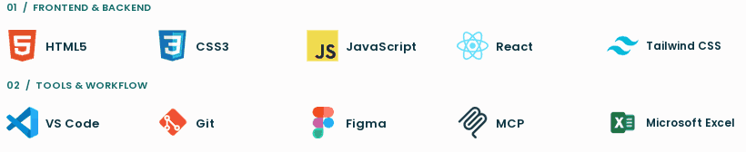
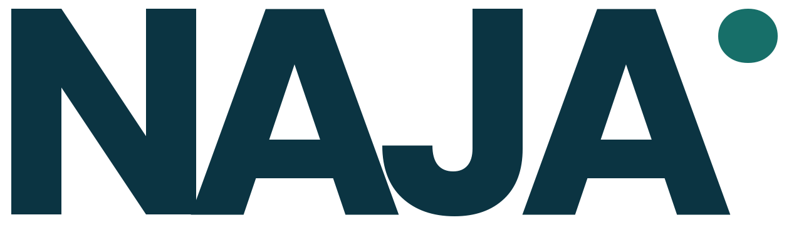

<!-- GitHub profile README for github.com/najaandika -->
<!-- Matches portfolio's typography and layout; real portrait, not an illustrated banner. -->
<!-- Navy #0B3442 · Teal #176F69 · Cream #F6F5EE -->

<table>
  <tr>
    <td width="64%" valign="middle">
      HELLO, I'M
      <h1>Naja Andika.</h1>
      

        <picture>
          <source media="(prefers-color-scheme: dark)" srcset="./profile/animations/role-typewriter-dark-v2.gif" />
          <source media="(prefers-color-scheme: light)" srcset="./profile/animations/role-typewriter-light-v2.gif" />
          
        </picture>
      

      
I build responsive, user-focused web applications with Laravel, React, and thoughtful UI design.

      
<strong>Information Systems Graduate</strong> Bachelor's Degree · 2026

      
<a href="https://www.najaandika.my.id/#projects">View My Work ↗</a> &nbsp;·&nbsp; <a href="https://cv-naja-andika.figma.site/">View CV ↗</a>

    </td>
    <td width="36%" align="right" valign="middle">
      
    </td>
  </tr>
</table>

---

01 / INTRODUCTION

### About my work

I work across **frontend, backend, and product UI**, from interactive websites to database-backed dashboards. My core stack is **Laravel + React**, supported by **Next.js, Astro, Tailwind CSS, MySQL, and Figma**.

I value maintainable code, clear user flows, responsive layouts, and interfaces that solve real business problems.

**Open to:** Junior developer opportunities · Freelance projects · Remote collaboration.

---

02 / PROJECTS

### Selected work

<!-- Project previews come from the deployed portfolio. Live demos and interactive designs are not claims of publicly available source code. -->
<table>
  <tr>
    <td width="50%" valign="top">
      
      <strong>AC &amp; Electronics Service Website</strong> 
      Responsive service website with streamlined service discovery and WhatsApp booking. 
      Astro · Tailwind CSS · Responsive UI 
      <a href="https://ac-service-website-one.vercel.app/">Live preview ↗</a>
    </td>
    <td width="50%" valign="top">
      
      <strong>JBL Concept Store — Interactive Audio Storefront</strong> 
      Immersive audio shopping concept with WebGL motion, product galleries, and simulated cart and checkout flows. 
      React · Vite · GSAP · WebGL 
      <a href="https://jblstore.vercel.app/">Live preview ↗</a>
    </td>
  </tr>
  <tr>
    <td width="50%" valign="top">
      
      <strong>LINEUP — Editorial Fashion Storefront</strong> 
      Runway-inspired fashion storefront with curated collections, product colourways, wishlist, and cart interactions. 
      React · TypeScript · React Router · Zustand 
      <a href="https://line-up-store.vercel.app/">Live preview ↗</a>
    </td>
    <td width="50%" valign="top">
      
      <strong>POS Counter &amp; QR Table Ordering</strong> 
      Restaurant POS with QR self-ordering, kitchen queues, and owner workflows. 
      Laravel · React · TypeScript · MySQL 
      <a href="https://www.najaandika.my.id/#projects">In development · Case study ↗</a>
    </td>
  </tr>
</table>

  
<strong>More projects</strong>

  

    <a href="https://e-commerce-mobile.figma.site/">Fashion Shopping App &amp; Admin Dashboard</a> — interactive fashion shopping and admin design concept. 
    <a href="https://moderen-e-commerce.figma.site/">E-Commerce Storefront Web UI</a> — responsive storefront and checkout concept. 
    <a href="https://parcelify.figma.site/">Parcel — Multi-Role Delivery App</a> — customer, courier, and admin experiences.
  

<a href="https://www.najaandika.my.id/#projects">Explore all projects ↗</a>

---

03 / TECHNICAL EXPERTISE

### Tech stack & tools

  <picture>
    <source media="(prefers-color-scheme: dark)" srcset="./profile/animations/tech-marquee-dark-v2.gif" />
    <source media="(prefers-color-scheme: light)" srcset="./profile/animations/tech-marquee-light-v2.gif" />
    
  </picture>

  
View the complete tech stack (text-only)

**Frontend & backend:** PHP · Laravel · JavaScript · TypeScript · React · Next.js · Astro · HTML · CSS · Tailwind CSS · MySQL · PostgreSQL · Vite

**Tools & workflow:** Figma · Git · GitHub · VS Code · Vercel · AWS · DigitalOcean · MCP · Microsoft Excel

---

04 / JOURNEY

### Experience & education

#### Experience

<table>
  <tr>
    <td valign="top">
      <strong>Web Developer &amp; UI/UX Designer</strong> 
      Freelance · Client Work &nbsp;|&nbsp; Sep 2026 — Present
      
Building responsive websites and web applications for clients, covering UI/UX design, development, and iterative improvements.

      Web Development · UI/UX Design
    </td>
  </tr>
  <tr>
    <td valign="top">
      <strong>Administrative &amp; Event Support Intern</strong> 
      Balai Guru Penggerak Lampung &nbsp;|&nbsp; Sep — Nov 2024
      
Supported visitor services, archiving, Excel reporting, event logistics, and registration for activities with 200+ participants.

      Operations · Documentation
    </td>
  </tr>
  <tr>
    <td valign="top">
      <strong>Digital Gaming Services</strong> 
      Freelance &nbsp;|&nbsp; 2022 — 2025
      
Managed client requests, agreed milestones, deadlines, and progress updates for digital gaming services.

      Client Service · Communication
    </td>
  </tr>
</table>

#### Education

<table>
  <tr>
    <td valign="top">
      <strong>B.Sc. Information Systems</strong> 
      Universitas Islam Negeri Raden Intan Lampung &nbsp;|&nbsp; 2021 — 2026
      
Faculty of Science and Technology 
      <strong>Focus:</strong> Full-Stack Web Development

    </td>
  </tr>
</table>

---

05 / CONTINUOUS LEARNING

### Verified credentials

**10 verified credentials** from Cisco Networking Academy, Google, and Macquarie University. These are the original badge and certificate images used in my portfolio. Click an image to view its public verification page.

<table>
  <tr>
    <td align="center" valign="top" width="25%">
       
      <strong>HTML Essentials</strong> 
      Cisco Networking Academy · 02 Sep 2026
    </td>
    <td align="center" valign="top" width="25%">
       
      <strong>CSS Essentials</strong> 
      Cisco Networking Academy · 02 Sep 2026
    </td>
    <td align="center" valign="top" width="25%">
       
      <strong>JavaScript Essentials 1</strong> 
      Cisco Networking Academy · 03 Sep 2026
    </td>
    <td align="center" valign="top" width="25%">
       
      <strong>JavaScript Essentials 2</strong> 
      Cisco Networking Academy · 03 Sep 2026
    </td>
  </tr>
  <tr>
    <td align="center" valign="top" width="25%">
       
      <strong>Operating Systems Basics</strong> 
      Cisco Networking Academy · 03 Sep 2026
    </td>
    <td align="center" valign="top" width="25%">
       
      <strong>Computer Hardware Basics</strong> 
      Cisco Networking Academy · 02 Sep 2026
    </td>
    <td align="center" valign="top" width="25%">
       
      <strong>IT Customer Support Basics</strong> 
      Cisco Networking Academy · 01 Sep 2026
    </td>
    <td align="center" valign="top" width="25%">
       
      <strong>Technical Support Fundamentals</strong> 
      Google · Coursera · 29 Aug 2026
    </td>
  </tr>
  <tr>
    <td align="center" valign="top" width="50%" colspan="2">
       
      <strong>Foundations: Data, Data, Everywhere</strong> 
      Google · Coursera · 05 Aug 2026
    </td>
    <td align="center" valign="top" width="50%" colspan="2">
       
      <strong>Excel Skills for Business: Essentials</strong> 
      Macquarie University · Coursera · 03 Aug 2026
    </td>
  </tr>
</table>

[View all my Credly badges](https://www.credly.com/users/naja-andika) · [Explore certifications on my portfolio](https://www.najaandika.my.id/#certifications)

---

06 / GITHUB ACTIVITY

### GitHub analytics

<!-- These cards fetch GitHub data when their image providers refresh their caches.
     Both palettes match the portfolio, including GitHub's automatic dark/light mode. -->

  <picture>
    <source media="(prefers-color-scheme: dark)" srcset="https://github-stats-extended.vercel.app/api?username=najaandika&amp;show_icons=true&amp;rank_icon=github&amp;include_all_commits=true&amp;hide_border=false&amp;border_color=24515A&amp;bg_color=0B3442&amp;title_color=F6F5EE&amp;text_color=DCEBE5&amp;icon_color=2DD4BF&amp;ring_color=2DD4BF" />
    <source media="(prefers-color-scheme: light)" srcset="https://github-stats-extended.vercel.app/api?username=najaandika&amp;show_icons=true&amp;rank_icon=github&amp;include_all_commits=true&amp;hide_border=false&amp;border_color=D8E5DF&amp;bg_color=F6F5EE&amp;title_color=0B3442&amp;text_color=34505A&amp;icon_color=176F69&amp;ring_color=176F69" />
    
  </picture>
  <picture>
    <source media="(prefers-color-scheme: dark)" srcset="https://github-stats-extended.vercel.app/api/top-langs/?username=najaandika&amp;layout=compact&amp;langs_count=8&amp;hide_border=false&amp;border_color=24515A&amp;bg_color=0B3442&amp;title_color=F6F5EE&amp;text_color=DCEBE5&amp;icon_color=2DD4BF" />
    <source media="(prefers-color-scheme: light)" srcset="https://github-stats-extended.vercel.app/api/top-langs/?username=najaandika&amp;layout=compact&amp;langs_count=8&amp;hide_border=false&amp;border_color=D8E5DF&amp;bg_color=F6F5EE&amp;title_color=0B3442&amp;text_color=34505A&amp;icon_color=176F69" />
    
  </picture>

  <picture>
    <source media="(prefers-color-scheme: dark)" srcset="https://streak-stats.demolab.com?user=najaandika&amp;hide_border=false&amp;stroke=24515A&amp;border=24515A&amp;background=0B3442&amp;ring=2DD4BF&amp;fire=2DD4BF&amp;currStreakLabel=2DD4BF&amp;sideLabels=F6F5EE&amp;currStreakNum=F6F5EE&amp;sideNums=F6F5EE&amp;dates=B7CBC5" />
    <source media="(prefers-color-scheme: light)" srcset="https://streak-stats.demolab.com?user=najaandika&amp;hide_border=false&amp;stroke=D8E5DF&amp;border=D8E5DF&amp;background=F6F5EE&amp;ring=176F69&amp;fire=176F69&amp;currStreakLabel=176F69&amp;sideLabels=0B3442&amp;currStreakNum=0B3442&amp;sideNums=0B3442&amp;dates=56706F" />
    
  </picture>

<!-- Stats are refreshed by the upstream provider's caching policy, not on each page view. -->

---

## Contribution Snake

  <picture>
    <source media="(prefers-color-scheme: dark)" srcset="https://raw.githubusercontent.com/najaandika/najaandika/output/github-contribution-grid-snake-dark.svg?v=github-default-20260823" />
    <source media="(prefers-color-scheme: light)" srcset="https://raw.githubusercontent.com/najaandika/najaandika/output/github-contribution-grid-snake.svg?v=github-default-20260823" />
    
  </picture>

---

  INDEPENDENT WEB DEVELOPER · DESIGN &amp; DEVELOPMENT

<h3 align="center">Let's make something amazing together.</h3>

  <a href="https://wa.me/6282125461418" title="Say hi to Naja Andika on WhatsApp">Start by saying hi ↗</a>

  <picture>
    <source media="(prefers-color-scheme: dark)" srcset="./profile/footer/wordmark-dark-transparent.png" />
    <source media="(prefers-color-scheme: light)" srcset="./profile/footer/wordmark-light-transparent.png" />
    
  </picture>

  &nbsp;&nbsp;
  &nbsp;&nbsp;
  &nbsp;&nbsp;
  

  © 2026 Naja Andika · Built with care.

