<!-- GitHub profile README for github.com/najaandika -->
<!-- Palette from the actual portfolio: Navy #0B3442 / Teal #176F69 / Cream #F6F5EE -->

  

  &nbsp;&nbsp;
  &nbsp;&nbsp;
  &nbsp;&nbsp;
  &nbsp;&nbsp;
  

---

### About me

I'm **Naja Andika**, a **Full-Stack Web Developer** and **Information Systems graduate (2026)** from UIN Raden Intan Lampung. I build practical, responsive applications that connect thoughtful interface design with reliable backend workflows.

My focus is **Laravel + React**, with experience across **Next.js, Astro, database-backed systems, dashboards, and UI/UX design**. I enjoy turning complex requirements into interfaces that feel clear and easy to use.

Currently open to **freelance projects, internships, and junior web developer opportunities**.

---

### Selected work

<!-- Project previews come from the deployed portfolio. These are live/design links, not claims of public source availability. -->
<table>
  <tr>
    <td width="50%" valign="top">
      
      <strong>AC &amp; Electronics Service Website</strong> 
      Responsive service website, clearer service discovery, and WhatsApp booking flow. 
      Astro · Tailwind CSS · Responsive UI 
      <a href="https://ac-service-website-one.vercel.app/">Live preview ↗</a>
    </td>
    <td width="50%" valign="top">
      
      <strong>BHD Gamification Learning Platform</strong> 
      Interactive, gamified first-aid learning experience. 
      React · Laravel · Gamification 
      <a href="https://bhd-hero.vercel.app/">Live preview ↗</a>
    </td>
  </tr>
  <tr>
    <td width="50%" valign="top">
      
      <strong>Fashion Shopping App &amp; Admin Dashboard</strong> 
      E-commerce experience with order tracking and staff management. 
      React · TypeScript · UI/UX 
      <a href="https://e-commerce-mobile.figma.site/">Interactive design ↗</a>
    </td>
    <td width="50%" valign="top">
      
      <strong>POS Counter &amp; QR Table Ordering</strong> 
      Restaurant POS with QR self-ordering, kitchen queues, and owner workflows. 
      Laravel · React · TypeScript · MySQL 
      <a href="https://portfolio-naja-andika.vercel.app/#projects">In development · Case study ↗</a>
    </td>
  </tr>
</table>

  
<strong>More projects</strong>

  

    <a href="https://moderen-e-commerce.figma.site/">E-Commerce Storefront Web UI</a> — responsive storefront and checkout concept. 
    <a href="https://parcelify.figma.site/">Parcel — Multi-Role Delivery App</a> — customer, courier, and admin experiences.
  

<a href="https://portfolio-naja-andika.vercel.app/#projects">Explore all projects ↗</a>

---

### Tech stack & tools

  

  
  

---

### GitHub analytics

<!-- These cards fetch GitHub data when their image providers refresh their caches.
     Both palettes match the portfolio, including GitHub's automatic dark/light mode. -->

  <picture>
    <source media="(prefers-color-scheme: dark)" srcset="https://github-readme-stats.vercel.app/api?username=najaandika&amp;show_icons=true&amp;rank_icon=github&amp;include_all_commits=true&amp;hide_border=false&amp;border_color=24515A&amp;bg_color=0B3442&amp;title_color=F6F5EE&amp;text_color=DCEBE5&amp;icon_color=2DD4BF&amp;ring_color=2DD4BF" />
    <source media="(prefers-color-scheme: light)" srcset="https://github-readme-stats.vercel.app/api?username=najaandika&amp;show_icons=true&amp;rank_icon=github&amp;include_all_commits=true&amp;hide_border=false&amp;border_color=D8E5DF&amp;bg_color=F6F5EE&amp;title_color=0B3442&amp;text_color=34505A&amp;icon_color=176F69&amp;ring_color=176F69" />
    
  </picture>
  <picture>
    <source media="(prefers-color-scheme: dark)" srcset="https://github-readme-stats.vercel.app/api/top-langs/?username=najaandika&amp;layout=compact&amp;langs_count=8&amp;hide_border=false&amp;border_color=24515A&amp;bg_color=0B3442&amp;title_color=F6F5EE&amp;text_color=DCEBE5&amp;icon_color=2DD4BF" />
    <source media="(prefers-color-scheme: light)" srcset="https://github-readme-stats.vercel.app/api/top-langs/?username=najaandika&amp;layout=compact&amp;langs_count=8&amp;hide_border=false&amp;border_color=D8E5DF&amp;bg_color=F6F5EE&amp;title_color=0B3442&amp;text_color=34505A&amp;icon_color=176F69" />
    
  </picture>

  <picture>
    <source media="(prefers-color-scheme: dark)" srcset="https://streak-stats.demolab.com?user=najaandika&amp;hide_border=false&amp;stroke=24515A&amp;border=24515A&amp;background=0B3442&amp;ring=2DD4BF&amp;fire=2DD4BF&amp;currStreakLabel=2DD4BF&amp;sideLabels=F6F5EE&amp;currStreakNum=F6F5EE&amp;sideNums=F6F5EE&amp;dates=B7CBC5" />
    <source media="(prefers-color-scheme: light)" srcset="https://streak-stats.demolab.com?user=najaandika&amp;hide_border=false&amp;stroke=D8E5DF&amp;border=D8E5DF&amp;background=F6F5EE&amp;ring=176F69&amp;fire=176F69&amp;currStreakLabel=176F69&amp;sideLabels=0B3442&amp;currStreakNum=0B3442&amp;sideNums=0B3442&amp;dates=56706F" />
    
  </picture>

<!-- Stats are refreshed by the upstream provider's caching policy, not on each page view. -->

---

### Contribution snake

<!-- Updated daily via .github/workflows/snake.yml on the profile repository.
     Custom dark and light palettes use the same navy-teal-cream brand colors. -->

  <picture>
    <source media="(prefers-color-scheme: dark)" srcset="https://raw.githubusercontent.com/najaandika/najaandika/output/github-contribution-grid-snake-dark.svg" />
    <source media="(prefers-color-scheme: light)" srcset="https://raw.githubusercontent.com/najaandika/najaandika/output/github-contribution-grid-snake.svg" />
    
  </picture>

---

<strong>Let's make something amazing together.</strong>

  &nbsp;&nbsp;
  &nbsp;&nbsp;
  

